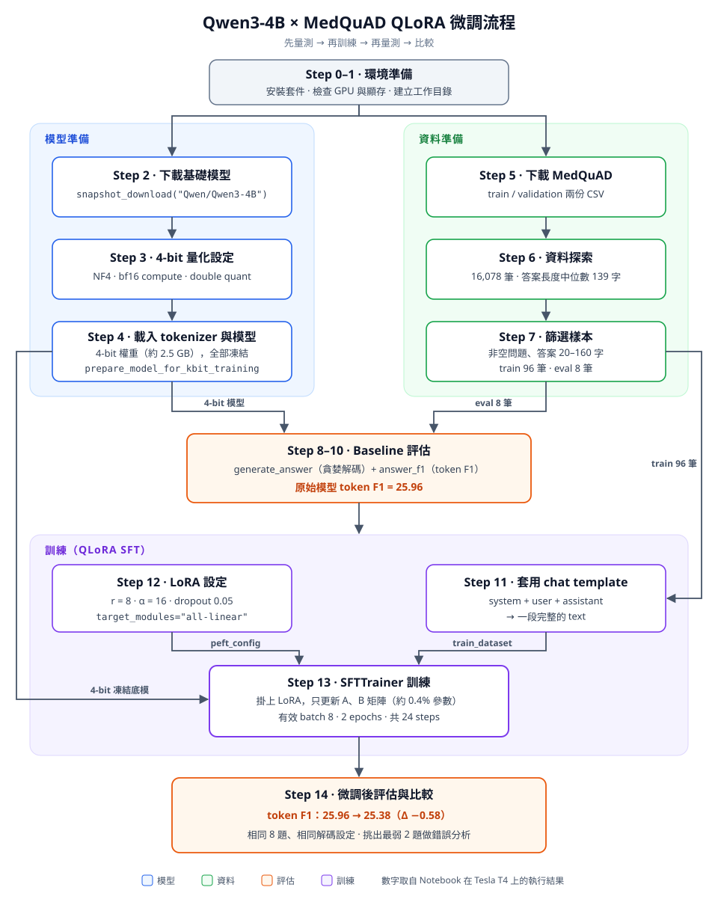

# Qwen3-4B × MedQuAD：用 QLoRA 微調醫療問答模型

本專案用 QLoRA 微調 Qwen3-4B 模型。訓練資料是 MedQuAD 醫療問答資料集。

本專案只需要一張 GPU。原始實驗使用 Colab 的 Tesla T4（16 GB 顯存）。

本專案在微調前和微調後各評估一次模型。評估指標是 token F1。

| 檔案 | 內容 |
| --- | --- |
| `Fine_tune_Qwen3_4B_with_QLoRA.ipynb` | Jupyter Notebook，包含執行結果 |
| `fine_tune_qwen3_4b_with_qlora.py` | 從 Notebook 匯出的 Python 程式碼。第 3 節逐段說明這個檔案 |

本文件的結構：

- 「微調的核心重點」用 8 點說明微調最重要的觀念。
- 第 1 節說明基礎知識。
- 第 2 節用一張圖說明整個流程。
- 第 3 節逐段說明程式碼。

---

## 微調的核心重點

**1. 微調是什麼**

微調從一個已經訓練好的模型開始。你用自己的資料再訓練這個模型。模型不從零開始學習，只改變一小部分行為。

**2. 微調可以學到什麼**

- 微調適合學習：回答的格式、長度、語氣和專業用詞。
- 微調不適合學習：大量的新知識。如果你需要新的資訊，使用 RAG（先找資料，再讓模型回答）。

**3. 訓練的原理**

模型讀取一段文字，然後預測下一個 token。預測錯誤的程度是 loss。訓練用 loss 調整參數。

SFT 給模型讀取「問題 + 標準答案」。模型學到：看到這個問題後，寫出這種答案。（[1.1 節](#11-語言模型如何產生文字)、[1.2 節](#12-預訓練和微調)）

**4. LoRA 和量化減少顯存**

- 全參數微調 4B 模型需要大約 64 GB 顯存。一般的 GPU 沒有這麼多顯存。
- **LoRA**：不訓練原本的權重。LoRA 加入兩個小矩陣，只訓練這兩個矩陣。LoRA 參數大約是模型參數的 0.4%。
- **量化**：用 4-bit 儲存不訓練的權重。模型從 8 GB 減少到大約 2.5 GB。
- **QLoRA** 同時使用 LoRA 和量化。所以一張 T4 可以微調 4B 模型。（[1.3–1.6 節](#13-全參數微調需要多少顯存)）

**5. 訓練和使用的格式必須相同**

訓練和使用模型時，都要使用相同的 chat template。如果格式不同，模型不能使用訓練學到的內容。（[1.7 節](#17-tokenizer-和-chat-template)）

**6. 資料比訓練參數重要**

- 資料的品質和數量對結果的影響最大。
- 錯誤的資料讓模型學到錯誤的內容。範例：問題是糖尿病，答案卻是中風。
- 本專案只有 96 筆訓練資料，所以分數幾乎沒有改變。（[4. 實驗結果](#4-實驗結果)）

**7. 在訓練前先做 baseline 評估**

流程是：**評估 → 訓練 → 再評估 → 比較**。

兩次評估要使用相同的題目、相同的解碼設定和相同的指標。這樣兩個分數才可以比較。（[2. 流程總覽](#2-流程總覽)）

**8. loss 變低不表示模型變好**

loss 只表示模型可以預測**訓練資料**。評估分數才表示模型可以處理**新資料**。

訓練資料太少時，模型可能只記住訓練資料。這個問題是 overfitting。（[6. 常見問題](#6-常見問題)）

**總結**：微調用好的資料、正確的格式和少量的訓練參數，讓已經訓練好的模型照你要的方式回答。前後一致的評估可以確認模型是否真的變好。

---

## 目錄

- [微調的核心重點](#微調的核心重點)
- [0. 快速開始](#0-快速開始)
- [1. 基礎知識](#1-基礎知識)
  - [1.1 語言模型如何產生文字](#11-語言模型如何產生文字)
  - [1.2 預訓練和微調](#12-預訓練和微調)
  - [1.3 全參數微調需要多少顯存](#13-全參數微調需要多少顯存)
  - [1.4 LoRA](#14-lora)
  - [1.5 量化和 NF4](#15-量化和-nf4)
  - [1.6 QLoRA](#16-qlora)
  - [1.7 Tokenizer 和 chat template](#17-tokenizer-和-chat-template)
  - [1.8 節省顯存的訓練方法](#18-節省顯存的訓練方法)
  - [1.9 評估指標：token F1](#19-評估指標token-f1)
- [2. 流程總覽](#2-流程總覽)
- [3. 程式碼說明](#3-程式碼說明)
- [4. 實驗結果](#4-實驗結果)
- [5. 改進方法](#5-改進方法)
- [6. 常見問題](#6-常見問題)
- [7. 參考資料](#7-參考資料)

---

## 0. 快速開始

### 硬體需求

- 一張 NVIDIA GPU，支援 CUDA。
- 顯存至少 12 GB。

### 在 Google Colab 執行

1. 把 `Fine_tune_Qwen3_4B_with_QLoRA.ipynb` 上傳到 Google Colab。
2. 在「執行階段類型」選擇 **T4 GPU**。
3. 從第一格開始，依序執行每一格。

### 在本機執行

> **注意**：`.py` 檔的第一段是 `!pip install`。這個指令只能在 Notebook 中執行。在本機執行前，先刪除這一段。

1. 安裝套件：

   ```bash
   pip install -U bitsandbytes==0.50.2 transformers==5.17.0 accelerate peft trl datasets
   ```

2. 刪除 `.py` 檔開頭的 `!pip install` 段落。
3. 執行程式：

   ```bash
   python fine_tune_qwen3_4b_with_qlora.py
   ```

### 原始實驗環境

```
Torch: 2.11.0+cu130   CUDA: 13.0   GPU: Tesla T4
bitsandbytes: 0.50.2  transformers: 5.17.0
```

---

## 1. 基礎知識

### 1.1 語言模型如何產生文字

Qwen3-4B 是一個語言模型。它只做一件事：讀取前面的 token，然後預測下一個 token。

```
輸入：  "高血壓 的 症狀 是"
模型：  預測下一個 token 的機率 → {"頭痛": 0.21, "頭暈": 0.15, "沒有": 0.08, ...}
```

模型用下面的步驟產生一段回答：

1. 預測下一個 token。
2. 把這個 token 加到輸入的後面。
3. 重複步驟 1 和 2。模型產生結束 token，或回答到達長度上限時，停止。

**訓練的目標**：模型給正確的下一個 token 越高的機率越好。

**loss** 是用來量測這個目標的數字。本專案使用 cross-entropy loss：

$$
\mathcal{L} = -\frac{1}{T}\sum_{t=1}^{T} \log P(x_t \mid x_{<t})
$$

loss 越低，模型越能預測訓練資料中的下一個 token。

### 1.2 預訓練和微調

| 階段 | 資料 | 目的 | 需要的 GPU |
| --- | --- | --- | --- |
| 預訓練 | 數兆個 token 的文字 | 學習語言和一般知識 | 數千張 GPU |
| 指令微調 | 數萬到數十萬組「指令 → 回答」 | 學習遵循指令 | 數張到數十張 GPU |
| 領域微調（本專案） | 數十到數萬組問答 | 學習一個領域的用詞和格式 | 一張 GPU |

本專案使用 **SFT**（supervised fine-tuning，監督式微調）。SFT 給模型看「問題 → 標準答案」的範例。模型用 1.1 節的 loss 學習這些範例。

> **注意**：微調可以改變模型回答的格式、長度和用詞。微調不適合加入大量新知識。如果你要模型使用新的資訊，使用 RAG（檢索增強生成）。

### 1.3 全參數微調需要多少顯存

全參數微調會更新模型的所有參數。Qwen3-4B 有大約 40 億個參數。

使用 Adam optimizer 時，每個參數需要下面的顯存：

| 項目 | 每個參數 | 40 億個參數 |
| --- | --- | --- |
| 權重（bf16） | 2 bytes | 約 8 GB |
| 梯度（bf16） | 2 bytes | 約 8 GB |
| Adam 狀態 m（fp32） | 4 bytes | 約 16 GB |
| Adam 狀態 v（fp32） | 4 bytes | 約 16 GB |
| 權重的 fp32 副本 | 4 bytes | 約 16 GB |
| **合計** | **約 16 bytes** | **約 64 GB** |

這個合計還不包含 activation。一張 T4 只有 16 GB 顯存，所以 T4 不能做全參數微調。

本專案用兩個方法減少顯存：

1. 只訓練少量的參數。這個方法是 **LoRA**（1.4 節）。
2. 用較少的位元儲存不訓練的權重。這個方法是 **量化**（1.5 節）。

### 1.4 LoRA

LoRA 是一種只訓練少量參數的微調方法。

#### LoRA 的原理

模型中的線性層計算 $y = Wx$。全參數微調會學習一個更新量 $\Delta W$：

$$
y = (W + \Delta W)x
$$

LoRA 不直接學習 $\Delta W$。LoRA 用兩個小矩陣 A 和 B 的乘積代替 $\Delta W$：

$$
\Delta W = \frac{\alpha}{r} \cdot B A, \quad A \in \mathbb{R}^{r \times d_{in}},\ B \in \mathbb{R}^{d_{out} \times r}
$$

```
              ┌──────────────────────┐
   x ───────▶ │  W（不訓練）          │ ─────────┐
   │          └──────────────────────┘          │
   │                                            ▼
   │     ┌─────────┐  r維  ┌─────────┐         (+) ───▶ y
   └───▶ │ A (r×d) │ ────▶ │ B (d×r) │ ── ×α/r ──┘
         └─────────┘       └─────────┘
          訓練               訓練（開始時等於 0）
```

LoRA 的重點：

- **W 不訓練**。W 不需要梯度，也不需要 Adam 狀態。
- **B 開始時等於 0**。所以訓練開始時 $\Delta W = 0$，模型的回答和基礎模型相同。
- **r** 是 A 和 B 的大小。r 越大，LoRA 參數越多。一般值是 4 到 64。
- **α** 是縮放係數。實際的縮放倍數是 $\alpha / r$。一般設定是 $\alpha = 2r$。

#### LoRA 參數的數量

範例：Qwen3-4B 的 `q_proj` 層，輸入 2560 維，輸出 4096 維。

- W 的參數：$2560 \times 4096 \approx$ 1,050 萬個。
- LoRA 參數（r=8）：$8 \times (2560 + 4096) \approx$ 5.3 萬個。這是 W 的 0.5%。

本專案在所有線性層加上 LoRA。LoRA 參數一共大約 1,650 萬個。這是模型參數的 0.4%。（這個數字是依照模型架構計算的估計值。）

#### 訓練完成後

你可以用兩種方式使用 LoRA 參數：

- **分開儲存**：LoRA 參數的檔案只有數十 MB。使用時，把它載入到基礎模型上。
- **合併**：計算 $W' = W + \frac{\alpha}{r}BA$。合併後，模型的速度和基礎模型相同。

### 1.5 量化和 NF4

**量化**是用較少的位元儲存每個權重。

| 格式 | 每個參數 | Qwen3-4B 的大小 |
| --- | --- | --- |
| fp32 | 4 bytes | 約 16 GB |
| bf16 | 2 bytes | 約 8 GB |
| int8 | 1 byte | 約 4 GB |
| **NF4（4-bit）** | **0.5 byte** | **約 2 GB** |

#### 量化的步驟

1. 把權重分成小組。每組有 64 個權重。
2. 找出每組中絕對值最大的權重。這個值是這組的 **scale**。
3. 把這組的每個權重除以 scale。結果在 -1 到 1 之間。
4. 把每個結果換成 16 個 4-bit 值中最接近的一個。

```
原始權重:  [0.12, -0.53, 0.07, 0.91, ...]   ← 每個 16 bits
           ↓ 除以 scale (0.91)
結果:      [0.13, -0.58, 0.08, 1.00, ...]
           ↓ 換成最接近的 4-bit 值
4-bit 值:  [ 9,    3,     8,    15,  ...]   ← 每個 4 bits，每組共用一個 scale
```

#### NF4

大部分權重接近 0，只有少數權重較大。

一般的 4-bit 格式（int4）把 16 個值平均放在 -1 到 1 之間。所以接近 0 的權重只能用少數幾個值表示。

**NF4** 在接近 0 的地方放較多的值，在兩端放較少的值。所以 NF4 對權重的誤差比 int4 小。

#### Double quantization

每組權重有一個 fp32 的 scale。每個參數平均要多用 0.5 bit。

**Double quantization** 把 scale 也量化成 8-bit。每個參數只多用大約 0.127 bit。Qwen3-4B 可以再減少大約 180 MB 顯存。

#### Compute dtype

4-bit 只是儲存格式。模型計算前，把權重轉回 compute dtype。本專案的 compute dtype 是 bf16。

- **儲存**：4-bit。這可以減少顯存。
- **計算**：bf16。這可以保持精度。

### 1.6 QLoRA

QLoRA 同時使用 LoRA 和 NF4 量化。

```
┌───────────────────────────────────────────────┐
│ 基礎模型 Qwen3-4B                              │
│   權重：NF4（4-bit），不訓練                   │  約 2.5 GB
│   計算時轉成 bf16                              │
├───────────────────────────────────────────────┤
│ LoRA 參數（每個線性層一組 A 和 B）             │
│   訓練                                         │  約 1,650 萬個參數
│   只有 LoRA 參數有梯度和 Adam 狀態             │
└───────────────────────────────────────────────┘
```

訓練時，梯度通過 4-bit 權重，但是只更新 LoRA 參數。

QLoRA 的結果：

- 一張 T4 可以微調 4B 模型。
- QLoRA 的結果和 16-bit LoRA 的結果接近。

### 1.7 Tokenizer 和 chat template

**Tokenizer** 把文字分成 token，然後把每個 token 換成一個數字（token ID）。模型只讀取 token ID。

**Chat template** 把一段對話換成一個固定格式的字串。Qwen3 使用下面的格式：

```text
<|im_start|>system
Answer the medical question clearly and concisely. ...<|im_end|>
<|im_start|>user
What are the symptoms of Male Breast Cancer ?<|im_end|>
<|im_start|>assistant
<think>

</think>

Men with breast cancer usually have lumps that can be felt. ...<|im_end|>
```

Qwen3-4B 用這個格式學習對話。所以評估和訓練都要使用這個格式。

> **注意**：如果訓練和評估使用不同的格式，模型不能使用訓練學到的內容。本專案的評估（`generate_answer`）和訓練（`format_example`）都使用 `apply_chat_template`。

**Thinking mode**：Qwen3 可以先在 `<think>...</think>` 中寫出推理過程，再寫回答。本專案只需要回答，所以設定 `enable_thinking=False`。這個設定加入一個空的 `<think></think>`。

### 1.8 節省顯存的訓練方法

| 方法 | 用途 | 缺點 |
| --- | --- | --- |
| **Gradient accumulation** | 累積數次的梯度，然後更新一次。這樣可以用小 batch 得到大 batch 的效果 | 每次更新需要較多時間 |
| **Gradient checkpointing** | 只儲存部分 activation。反向傳播時，再計算其他 activation | 訓練時間增加大約 30% |
| **bf16** | 用 16 bits 計算，減少顯存並增加速度 | 精度比 fp32 低 |

**有效 batch size** = `per_device_train_batch_size` × `gradient_accumulation_steps` × GPU 數量 = 2 × 4 × 1 = **8**

**Learning rate**：LoRA 參數少，而且開始時等於 0。所以 LoRA 的 learning rate 比全參數微調的大。如果 learning rate 太大，訓練會不穩定。

### 1.9 評估指標：token F1

醫療問題可以有很多正確的回答。本專案用 **token F1** 比較模型的回答和標準答案。

token F1 的計算步驟：

1. 把模型的回答和標準答案都分成單字。
2. 計算兩者相同的單字數量。這是「重疊字數」。
3. 用下面的公式計算：

$$
\text{Precision} = \frac{\text{重疊字數}}{\text{回答字數}}, \quad
\text{Recall} = \frac{\text{重疊字數}}{\text{標準答案字數}}, \quad
F1 = \frac{2PR}{P+R}
$$

- **Precision 低**：回答中有很多標準答案沒有的單字。
- **Recall 低**：回答缺少標準答案中的單字。

> **注意**：token F1 只比較單字，不比較意思。「是癌症」和「不是癌症」可以得到很高的 token F1。不要用 token F1 判斷醫療回答是否正確。

---

## 2. 流程總覽



圖中的顏色表示四種工作：

| 顏色 | 工作 | 步驟 | 內容 |
| --- | --- | --- | --- |
| 藍色 | 模型準備 | Step 2–4 | 下載 Qwen3-4B，用 NF4 載入，凍結權重 |
| 綠色 | 資料準備 | Step 5–7 | 下載 MedQuAD，選出 96 筆訓練資料和 8 筆評估資料 |
| 橘色 | 評估 | Step 8–10、14 | 在微調前和微調後各評估一次 |
| 紫色 | 訓練 | Step 11–13 | 用 `SFTTrainer` 訓練 LoRA 參數 |

流程的規則：

- 模型準備和資料準備沒有先後關係。
- Baseline 評估需要模型和評估資料。所以 Baseline 評估在 Step 4 和 Step 7 完成後開始。
- `SFTTrainer` 需要三個輸入：
  - `model`：4-bit 基礎模型
  - `peft_config`：LoRA 設定
  - `train_dataset`：用 chat template 處理後的訓練資料
- 兩次評估使用相同的 8 題、相同的解碼設定和相同的 token F1。所以兩個分數可以比較。

> **注意**：在訓練前，一定要先做 baseline 評估。沒有 baseline，你不能知道微調是否有效果。

---

## 3. 程式碼說明

本節依照 `fine_tune_qwen3_4b_with_qlora.py` 的順序說明程式碼。

### Step 0：安裝套件和檢查環境

```python
!pip install -q -U \
    bitsandbytes==0.50.2 \
    transformers==5.17.0 \
    accelerate \
    peft \
    trl \
    datasets
```

| 套件 | 用途 |
| --- | --- |
| `transformers` | 載入模型和 tokenizer，產生文字 |
| `bitsandbytes` | 提供 4-bit 和 8-bit 量化。NF4 在這個套件中 |
| `accelerate` | 把模型放到 GPU，處理混合精度 |
| `peft` | 提供 LoRA |
| `trl` | 提供 `SFTTrainer` |
| `datasets` | 下載和處理資料集 |

```python
from transformers.utils import is_bitsandbytes_available
print("Transformers sees bitsandbytes:", is_bitsandbytes_available())
```

這段程式碼印出套件版本，並檢查 transformers 是否可以使用 bitsandbytes。

bitsandbytes 必須和 CUDA、PyTorch 的版本相容。版本不相容是 QLoRA 最常見的錯誤。本專案固定 `bitsandbytes` 和 `transformers` 的版本，所以其他人可以得到相同的結果。

---

### Step 1：檢查 GPU 和建立資料夾

```python
if not torch.cuda.is_available():
    raise RuntimeError("A GPU is required for this project")

device = torch.device("cuda")
print(torch.cuda.get_device_name(0))
print(f"Memory: {torch.cuda.get_device_properties(0).total_memory / 1024**3:.1f} GB")
```

bitsandbytes 的 4-bit 計算只能在 CUDA GPU 上執行。如果沒有 GPU，程式立即停止。這樣可以避免下載模型後才發現錯誤。

程式印出顯存大小。你可以用這個數字選擇 batch size 和最大長度。

```python
WORKSPACE = "/tmp/tensortonic"
DATA_DIR = os.path.join(WORKSPACE, "data", "medquad")
MODEL_DIR = os.path.join(WORKSPACE, "models")
MODEL_CACHE = os.path.join(MODEL_DIR, "huggingface")
DATASET_CACHE = os.path.join(WORKSPACE, "cache", "datasets")
```

這段程式碼為模型、資料集快取和處理後的資料建立不同的資料夾。模型檔案大約 8 GB。不同的資料夾可以讓你容易找到和刪除檔案。

---

### Step 2：下載基礎模型

```python
MODEL_ID = "Qwen/Qwen3-4B"
local_model_path = snapshot_download(MODEL_ID, cache_dir=MODEL_CACHE)
```

`snapshot_download` 從 Hugging Face Hub 下載模型的所有檔案。這些檔案包括權重、`config.json` 和 tokenizer 檔案。這個函式回傳本機的路徑。之後的程式碼從這個路徑載入模型。

本專案選擇 Qwen3-4B 的原因：

- Qwen3-4B 已經做過指令微調，可以使用 chat template。
- 量化後，Qwen3-4B 大約是 2.5 GB。T4 有足夠的顯存訓練它。

---

### Step 3：設定 4-bit 量化（TODO 1）

```python
quantization = BitsAndBytesConfig(
    load_in_4bit=True,
    bnb_4bit_quant_type="nf4",
    bnb_4bit_compute_dtype=torch.bfloat16,
    bnb_4bit_use_double_quant=True,
)
```

這些參數的說明在 [1.5 節](#15-量化和-nf4)。

| 參數 | 用途 |
| --- | --- |
| `load_in_4bit=True` | 載入模型時，把線性層的權重量化成 4-bit |
| `bnb_4bit_quant_type="nf4"` | 使用 NF4 格式 |
| `bnb_4bit_compute_dtype=torch.bfloat16` | 計算前，把權重轉成 bf16 |
| `bnb_4bit_use_double_quant=True` | 把 scale 也量化，減少顯存 |

> **注意**：只有線性層被量化。Embedding 和 LayerNorm 不被量化。

---

### Step 4：載入 tokenizer 和模型

```python
tokenizer = AutoTokenizer.from_pretrained(local_model_path)
if tokenizer.pad_token is None:
    tokenizer.pad_token = tokenizer.eos_token
```

一個 batch 中的句子長度不同。模型需要長度相同的輸入。所以 tokenizer 在短句子的後面加入 **pad token**。

如果模型沒有 pad token，這段程式碼使用 EOS token 作為 pad token。Attention mask 讓模型忽略 pad token。

```python
base_model = AutoModelForCausalLM.from_pretrained(
    local_model_path,
    quantization_config=quantization,
    device_map={"": 0},
    torch_dtype=torch.bfloat16,
)
```

| 參數 | 用途 |
| --- | --- |
| `quantization_config` | 使用 Step 3 的設定。載入時量化權重，所以 8 GB 的 bf16 權重不會全部放到 GPU 上 |
| `device_map={"": 0}` | 把整個模型放到 GPU 0 |
| `torch_dtype=torch.bfloat16` | 用 bf16 載入沒有量化的層 |

> **注意**：新版 transformers 使用 `dtype=` 代替 `torch_dtype=`。程式執行時會顯示警告。這個警告不會改變結果。

```python
base_model.config.use_cache = False
```

模型產生文字時，使用 **KV cache** 儲存之前 token 的計算結果。訓練不需要 KV cache。KV cache 也不能和 gradient checkpointing 一起使用。所以訓練前關閉 KV cache。

```python
base_model = prepare_model_for_kbit_training(base_model)
```

這個 PEFT 函式準備量化模型的訓練。它做下面的工作：

1. 凍結所有權重（`requires_grad=False`）。
2. 把 LayerNorm 等小層轉成 fp32。這樣訓練較穩定。
3. 讓梯度可以通過 embedding 層。這樣 gradient checkpointing 開啟時，梯度可以到達 LoRA 參數。
4. 開啟 gradient checkpointing。

---

### Step 5：下載 MedQuAD 資料集

```python
DATASET_ID = "Hmehdi515/MedQuad"
DATASET_FILES = {
    "train": ".../medquad_train.csv",
    "validation": ".../medquad_val.csv",
}
source = load_dataset("csv", data_files=DATASET_FILES, cache_dir=DATASET_CACHE)
```

**MedQuAD** 是一個醫療問答資料集。資料來自美國 NIH 的網站，例如 MedlinePlus 和 NCI。問題包括症狀、原因、治療和預防。

這個資料集有兩個檔案：train 和 validation。本專案從 train 選訓練資料，從 validation 選評估資料。

> **注意**：不要用訓練資料評估模型。模型已經看過訓練資料，所以分數會太高。

```python
source["train"].to_json(raw_train_path)
source["validation"].to_json(raw_validation_path)
```

這段程式碼把原始資料儲存成 JSONL 檔案。你可以用這些檔案檢查資料。

---

### Step 6：檢查資料（TODO 2）

```python
columns = source["train"].column_names

answer_lengths = sorted(
    len(answer.split())
    for answer in source["train"]["answer"]
)
median_answer_words = answer_lengths[len(answer_lengths) // 2]
```

在訓練前，一定要先檢查資料。這段程式碼做兩件事：

1. **檢查欄位**：確認資料有 `question` 和 `answer`。實際的欄位是 `['sample', 'question', 'answer']`。
2. **計算答案長度的中位數**：結果是 **139 個字**。訓練資料一共有 **16,078 筆**。

本專案使用中位數，不使用平均數。原因：少數答案有上千個字，這些答案讓平均數變大。中位數不受這些答案影響。

Step 7 使用這個數字設定篩選條件。

---

### Step 7：選擇訓練資料和評估資料（TODO 3）

```python
def select_examples(split, limit):
    rows = []
    for example in source[split]:
        question = str(example["question"]).strip()
        answer = str(example["answer"]).strip()
        answer_words = len(answer.split())

        keep_example = bool(question) and 20 <= answer_words <= 160
        if keep_example:
            rows.append({"question": question, "answer": answer})
        if len(rows) == limit:
            break
    return Dataset.from_list(rows)
```

| 條件 | 原因 |
| --- | --- |
| `bool(question)` | 刪除沒有問題的資料 |
| `answer_words >= 20` | 刪除太短的答案。太短的答案沒有足夠的資訊 |
| `answer_words <= 160` | 刪除太長的答案。訓練時，超過 384 token 的部分會被刪除，模型會學到不完整的答案 |

160 個字大約是 200 到 250 個 token。加上 system prompt 和問題後，長度在 384 token 以內。

```python
dataset = DatasetDict({
    "train": select_examples("train", 96).shuffle(seed=42),
    "evaluation": select_examples("validation", 8),
})
```

- 本專案只用 96 筆訓練資料和 8 筆評估資料。這樣整個流程可以在數分鐘內完成。實際的專案需要數千筆以上的資料。
- `.shuffle(seed=42)` 打亂訓練資料的順序。MedQuAD 中，相同疾病的問題常常在一起。打亂順序可以讓每個 batch 有不同的疾病。`seed=42` 讓每次的順序相同。

```python
SYSTEM_PROMPT = (
    "Answer the medical question clearly and concisely. When a question "
    "requires personal medical advice, recommend consulting a qualified clinician."
)
```

**System prompt** 告訴模型它的工作和規則。訓練和評估都使用這個 system prompt。

---

### Step 8：產生回答（TODO 4）

```python
def generate_answer(model, question):
    messages = [
        {"role": "system", "content": SYSTEM_PROMPT},
        {"role": "user",   "content": str(question).strip()},
    ]
    inputs = tokenizer.apply_chat_template(
        messages,
        tokenize=True,
        add_generation_prompt=True,
        return_tensors="pt",
        return_dict=True,
        enable_thinking=False,
    )
```

`apply_chat_template` 的參數：

| 參數 | 用途 |
| --- | --- |
| `tokenize=True` | 回傳 token ID，不回傳字串 |
| `add_generation_prompt=True` | 在最後加入 `<|im_start|>assistant\n`。這告訴模型開始回答 |
| `return_tensors="pt"` | 回傳 PyTorch tensor |
| `return_dict=True` | 回傳 `input_ids` 和 `attention_mask` |
| `enable_thinking=False` | 關閉 thinking mode |

```python
    inputs = {key: value.to(model.device) for key, value in inputs.items()}
    prompt_length = inputs["input_ids"].shape[-1]
    with torch.inference_mode():
        output = model.generate(
            **inputs,
            max_new_tokens=160,
            do_sample=False,
            pad_token_id=tokenizer.pad_token_id,
        )
    return tokenizer.decode(output[0][prompt_length:], skip_special_tokens=True).strip()
```

| 程式碼 | 用途 |
| --- | --- |
| `torch.inference_mode()` | 不計算梯度。這可以減少顯存並增加速度 |
| `max_new_tokens=160` | 回答最多 160 個 token |
| `do_sample=False` | 使用 **greedy decoding**：每一步都選機率最高的 token。相同的輸入一定得到相同的回答 |
| `output[0][prompt_length:]` | `generate` 的輸出包含輸入的 prompt。這段程式碼刪除 prompt，只留下回答 |

> **注意**：評估時，使用 `do_sample=False`。如果回答每次不同，你不能比較微調前和微調後的分數。

---

### Step 9：計算 token F1（TODO 5）

```python
def answer_f1(prediction, reference):
    predicted_tokens = re.findall(r"\w+", prediction.lower())
    reference_tokens = re.findall(r"\w+", reference.lower())

    if not predicted_tokens or not reference_tokens:
        return float(predicted_tokens == reference_tokens)
    overlap = sum((Counter(predicted_tokens) & Counter(reference_tokens)).values())
    if overlap == 0:
        return 0.0
    precision = overlap / len(predicted_tokens)
    recall = overlap / len(reference_tokens)
    return 2 * precision * recall / (precision + recall)
```

這個函式的步驟：

1. 把文字轉成小寫。用 `\w+` 找出所有單字，忽略標點。所以 `"Cancer."` 和 `"cancer"` 是相同的單字。
2. 如果回答或標準答案沒有單字：兩者都沒有單字時，回傳 1；其他情況回傳 0。這樣可以避免除以 0。
3. 用 `Counter(a) & Counter(b)` 計算重疊字數。每個單字取兩邊出現次數中較小的數。範例：回答有 3 個 "the"，標準答案有 2 個 "the"，重疊字數是 2。所以重複同一個單字不能增加分數。
4. 用 [1.9 節](#19-評估指標token-f1) 的公式計算 F1。

```python
def evaluate_model(model, rows):
    model.eval()
    results = []
    for row in rows:
        prediction = generate_answer(model, row["question"])
        score = answer_f1(prediction, row["answer"])
        results.append({..., "token_f1": round(score * 100, 2)})
    return {
        "token_f1": round(sum(row["token_f1"] for row in results) / len(results), 2),
        "examples": len(results),
        "results": results,
    }
```

這個函式的步驟：

1. `model.eval()` 關閉 dropout。這樣每次的結果相同。
2. 為每一題產生回答，並計算 token F1。
3. 計算所有題目的平均分數（0 到 100）。
4. 回傳平均分數和每一題的結果。你可以用每一題的結果找出問題。

---

### Step 10：Baseline 評估

```python
baseline = evaluate_model(base_model, dataset["evaluation"])
```

**Baseline** 是基礎模型在微調前的分數。

這一步在訓練前評估基礎模型。它使用的評估資料、解碼設定和指標都和 Step 14 相同。

原始實驗的結果：**baseline token F1 = 25.96**

> **注意**：這時 `base_model` 還沒有 LoRA 參數。這個分數是 4-bit 基礎模型的分數。

---

### Step 11：把訓練資料轉成對話格式（TODO 6）

```python
def format_example(example):
    messages = [
        {"role": "system",    "content": SYSTEM_PROMPT},
        {"role": "user",      "content": example["question"]},
        {"role": "assistant", "content": example["answer"]},
    ]
    text = tokenizer.apply_chat_template(
        messages,
        tokenize=False,
        enable_thinking=False,
    )
    return {"text": text}

train = dataset["train"].map(format_example)
```

`generate_answer`（Step 8）和 `format_example` 的不同：

| | `generate_answer`（評估） | `format_example`（訓練） |
| --- | --- | --- |
| messages | system + user | system + user + **assistant（標準答案）** |
| `add_generation_prompt` | `True`：讓模型寫回答 | 不使用：標準答案已經在 messages 中 |
| `tokenize` | `True`：回傳 token ID | `False`：回傳字串。`SFTTrainer` 之後把字串轉成 token ID |

SFT 的原理：模型讀取完整的對話，包括標準答案。模型用 1.1 節的 loss 學習。模型學到：看到這個 system prompt 和這個問題後，寫出這個答案。

`dataset.map()` 對每一筆資料執行 `format_example`。結果是一個新的 `text` 欄位。

> **注意**：本專案用整段 `text` 計算 loss。所以模型也學習預測 system prompt 和問題。另一個方法是只用 assistant 的部分計算 loss。這個方法讓模型只學習回答。

---

### Step 12：設定 LoRA（TODO 7）

```python
lora = LoraConfig(
    r=8,
    lora_alpha=16,
    lora_dropout=0.05,
    bias="none",
    target_modules="all-linear",
    task_type="CAUSAL_LM",
)
```

這些參數的說明在 [1.4 節](#14-lora)。

| 參數 | 值 | 用途 |
| --- | --- | --- |
| `r` | 8 | A 和 B 的大小 |
| `lora_alpha` | 16 | 縮放係數。縮放倍數是 16 / 8 = 2 |
| `lora_dropout` | 0.05 | 訓練時，隨機關閉 5% 的 LoRA 輸入。這可以減少 overfitting。本專案只有 96 筆訓練資料，所以容易 overfitting |
| `bias` | `"none"` | 不訓練 bias |
| `target_modules` | `"all-linear"` | 在所有線性層加入 LoRA。`lm_head` 除外 |
| `task_type` | `"CAUSAL_LM"` | 告訴 PEFT 這是語言模型 |

Qwen3 的每一層有 7 個線性層：

```
Attention:  q_proj, k_proj, v_proj, o_proj
MLP:        gate_proj, up_proj, down_proj
```

早期的 LoRA 只在 `q_proj` 和 `v_proj` 加入 LoRA。QLoRA 論文的結果：在所有線性層加入 LoRA，結果較好。

> **注意**：這一步只建立設定。Step 13 的 `SFTTrainer` 才把 LoRA 加到模型上。

---

### Step 13：訓練（TODO 8）

```python
training_config = SFTConfig(
    output_dir="/tmp/qwen-medquad",
    learning_rate=0.0002,
    num_train_epochs=2,
    per_device_train_batch_size=2,
    gradient_accumulation_steps=4,
    max_length=384,
    logging_steps=1,
    save_strategy="no",
    report_to=[],
    bf16=True,
    gradient_checkpointing=True,
    dataset_text_field="text",
    seed=42,
)
```

| 參數 | 值 | 用途 |
| --- | --- | --- |
| `learning_rate` | 2e-4 | LoRA 的一般值。全參數微調一般用 1e-5 到 2e-5 |
| `num_train_epochs` | 2 | 讀取所有訓練資料 2 次 |
| `per_device_train_batch_size` | 2 | 每次計算 2 筆資料 |
| `gradient_accumulation_steps` | 4 | 累積 4 次梯度，然後更新一次。有效 batch size 是 8 |
| `max_length` | 384 | 每筆資料最多 384 個 token。超過的部分被刪除 |
| `logging_steps` | 1 | 每一步都印出 loss |
| `save_strategy` | `"no"` | 不儲存 checkpoint |
| `report_to` | `[]` | 不把結果傳送到 W&B 或 TensorBoard |
| `bf16` | True | 使用 bf16 計算 |
| `gradient_checkpointing` | True | 減少顯存，增加訓練時間 |
| `dataset_text_field` | `"text"` | 使用 Step 11 的 `text` 欄位訓練 |
| `seed` | 42 | 讓每次的結果相同 |

**更新次數**：96 筆 ÷ 8 = 每個 epoch 12 次。2 個 epoch 一共 **24 次**。

> **注意**：T4 的硬體不支援 bf16。PyTorch 用軟體執行 bf16，所以速度較慢。如果發生 bf16 錯誤，做下面的修改：
>
> 1. 把 `bf16=True` 改成 `fp16=True`。
> 2. 把 Step 3 的 `bnb_4bit_compute_dtype` 改成 `torch.float16`。
>
> A100、L4 和 RTX 30 系列以上的 GPU 支援 bf16。在這些 GPU 上，使用 bf16。

```python
trainer = SFTTrainer(
    model=base_model,
    args=training_config,
    train_dataset=train,
    peft_config=lora,
    processing_class=tokenizer,
)
train_result = trainer.train()
```

`SFTTrainer` 做下面的工作：

1. **加入 LoRA**：用 `peft_config` 在每個線性層加入 A 和 B。基礎模型的權重保持凍結。
2. **轉換資料**：用 tokenizer 把 `text` 轉成 token ID。刪除超過 `max_length` 的部分。
3. **建立 batch**：加入 pad token，建立 attention mask 和 labels。labels 和 token ID 相同。模型自動用每個 token 預測下一個 token。
4. **訓練**：重複下面的步驟。

```
for epoch in range(2):
    for step, batch in enumerate(dataloader):        # 每個 batch 有 2 筆資料
        loss = model(**batch).loss / 4                # 除以累積次數
        loss.backward()                               # 只計算 LoRA 參數的梯度
        if (step + 1) % 4 == 0:
            optimizer.step()                          # 更新 LoRA 參數
            scheduler.step()                          # 調整 learning rate
            optimizer.zero_grad()                     # 清除梯度
```

`train_result.training_loss` 是整個訓練的平均 loss。

---

### Step 14：微調後評估（TODO 9）

```python
trainer.model.eval()
fine_tuned_result = evaluate_model(trainer.model, dataset["evaluation"])
```

`trainer.model` 是基礎模型加上訓練後的 LoRA 參數。這一步用 Step 10 相同的 8 題、相同的解碼設定和相同的指標評估這個模型。

```python
score_change = fine_tuned_result["token_f1"] - baseline["token_f1"]

weakest = sorted(
    fine_tuned_result["results"],
    key=lambda row: row["token_f1"]
)[:2]
```

- `score_change`：微調後分數減去 baseline 分數。正數表示分數增加。
- `weakest`：分數最低的 2 題。

檢查分數最低的題目，找出模型錯誤的原因。這些原因告訴你下一步要修改資料、prompt 還是訓練參數。

---

## 4. 實驗結果

原始實驗在 Tesla T4 上的結果：

| 項目 | 數值 |
| --- | --- |
| 訓練資料 | 96 筆 |
| 評估資料 | 8 筆 |
| 更新次數 | 24 |
| Baseline token F1 | **25.96** |
| 微調後 token F1 | **25.38** |
| 差異 | **−0.58** |

微調後分數沒有增加。這個結果不表示程式有錯誤。下面是可能的原因：

1. **訓練資料太少**：只有 96 筆資料和 24 次更新。這對 4B 模型的影響很小。
2. **評估資料太少**：只有 8 題。一題的分數改變，平均分數就會改變很多。所以 −0.58 和 0 沒有明顯的不同。
3. **token F1 只比較單字**：模型的回答可能正確，但是使用的單字和標準答案不同。這時分數會變低。
4. **資料有錯誤**：分數最低的一題問的是「預防糖尿病問題」的症狀，但是標準答案說明的是中風的症狀。模型不可能回答正確。
5. **回答長度的限制**：`max_new_tokens=160` 可能在回答完成前停止模型。這讓 recall 變低。

---

## 5. 改進方法

下表的順序是建議的順序。第一項的效果最大。

| 方法 | 做法 | 預期結果 |
| --- | --- | --- |
| 增加訓練資料 | 把 `select_examples("train", 96)` 改成 2,000 到 10,000 | 分數最可能增加 |
| 增加評估資料 | 把評估資料改成 100 到 200 題 | 分數的差異較可靠 |
| 只用回答計算 loss | 使用 `prompt`/`completion` 格式的資料，或設定 assistant-only loss | 模型只學習回答 |
| 清理資料 | 刪除問題和答案不相關的資料 | 模型不學習錯誤的資料 |
| 修改訓練參數 | `r=16`、`lora_alpha=32`、`num_train_epochs=3` | 模型可以學習較多內容。注意 overfitting |
| 使用其他指標 | ROUGE-L、BERTScore，或用另一個 LLM 評分 | 分數較能反映回答的意思 |
| 儲存 LoRA 參數 | `trainer.save_model("qwen3-medquad-lora")` | 之後可以再載入或合併 |

### 儲存和載入 LoRA 參數

1. 訓練後，儲存 LoRA 參數和 tokenizer。檔案大約數十 MB：

   ```python
   trainer.save_model("qwen3-medquad-lora")
   tokenizer.save_pretrained("qwen3-medquad-lora")
   ```

2. 之後，載入基礎模型和 LoRA 參數：

   ```python
   from peft import PeftModel
   base = AutoModelForCausalLM.from_pretrained("Qwen/Qwen3-4B", quantization_config=quantization, device_map={"": 0})
   model = PeftModel.from_pretrained(base, "qwen3-medquad-lora")
   ```

---

## 6. 常見問題

**Q：發生 `CUDA out of memory` 錯誤。我要怎麼做？**

依照下面的順序修改。每次修改後，再執行一次。

1. 把 `per_device_train_batch_size` 改成 1，並把 `gradient_accumulation_steps` 改成 8。有效 batch size 保持 8。
2. 減少 `max_length`。
3. 減少 LoRA 的 `r`。

**Q：為什麼 baseline 使用 4-bit 模型，不使用 bf16 模型？**

微調後的模型是 4-bit 基礎模型加上 LoRA 參數。Baseline 也使用 4-bit 基礎模型。所以兩個模型只有 LoRA 參數不同。分數的差異只來自微調。

**Q：QLoRA 和 LoRA 的結果差多少？**

QLoRA 論文的結果：在大部分測試中，QLoRA（NF4 + double quantization）和 16-bit LoRA 的結果接近。

**Q：`training_loss` 變低了，但是評估分數沒有增加。為什麼？**

loss 量測模型對**訓練資料**的預測。評估分數量測模型對**新資料**的表現。訓練資料太少時，模型可能只記住訓練資料，不能處理新資料。這個問題是 **overfitting**。

**Q：我可以用這個模型提供醫療建議嗎？**

> **警告**：不可以。這是一個教學專案。模型可能產生錯誤的醫療資訊。所以 system prompt 告訴模型：問題需要個人醫療建議時，建議使用者諮詢醫師。

---

## 7. 參考資料

- **LoRA**：Hu et al., *LoRA: Low-Rank Adaptation of Large Language Models*, 2021. [arXiv:2106.09685](https://arxiv.org/abs/2106.09685)
- **QLoRA**：Dettmers et al., *QLoRA: Efficient Finetuning of Quantized LLMs*, 2023. [arXiv:2305.14314](https://arxiv.org/abs/2305.14314)
- **MedQuAD**：Ben Abacha & Demner-Fushman, *A Question-Entailment Approach to Question Answering*, 2019. [arXiv:1901.08079](https://arxiv.org/abs/1901.08079)
- **Qwen3**：[Qwen/Qwen3-4B on Hugging Face](https://huggingface.co/Qwen/Qwen3-4B)
- Hugging Face 文件：[PEFT](https://huggingface.co/docs/peft)、[TRL SFTTrainer](https://huggingface.co/docs/trl/sft_trainer)、[bitsandbytes](https://huggingface.co/docs/bitsandbytes)
